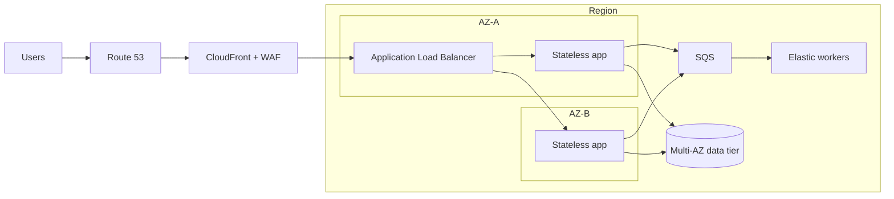

  

<h1 align="center">AWS Solutions Architect Associate Study Guide</h1>

An independent, scenario-first path through the AWS Certified Solutions Architect – Associate (SAA-C03) exam.

  
  
  
  

> [!IMPORTANT]
> This is an unofficial learning resource, not an exam dump. It is not affiliated with or endorsed by Amazon Web Services. Service behavior, pricing, limits, and exam details change; verify decisions against current AWS documentation.

## About this guide

SAA-C03 tests architecture judgment more than isolated facts. This guide teaches you to turn requirements—availability, latency, security, recovery, operational effort, and cost—into defensible AWS design choices. It is intended for cloud engineers, system administrators, developers, and architects with foundational AWS knowledge.

| 1. Find your gaps | 2. Study by domain | 3. Practice decisions |
|:---:|:---:|:---:|
| [Take the diagnostic →](practice/questions.md) | [Choose a study plan →](STUDY-PLAN.md) | [Complete the labs →](labs/README.md) |
| 20 original scenarios | 20-hour or six-week route | Console-optional design work |

## Exam snapshot

Verified **2026-10-22** against the [official certification page](https://aws.amazon.com/certification/certified-solutions-architect-associate/) and [official exam guide](https://docs.aws.amazon.com/aws-certification/latest/solutions-architect-associate-03.html):

| Item | Current detail |
|---|---|
| Exam | SAA-C03 |
| Format | 65 multiple-choice or multiple-response questions |
| Scoring | 50 scored + 15 unscored; unscored items are not identified |
| Time | 130 minutes |
| Price | USD 150; check taxes and regional pricing |
| Passing score | 720 on a 100–1,000 scale |
| Delivery | Pearson VUE test center or online proctored |
| Recommended experience | At least one year designing cloud solutions on AWS |
| Validity | Three years |

## Official blueprint

| Domain | Weight | 20-hour plan |
|---|---:|---:|
| [Design Secure Architectures](domains/01-secure-architectures.md) | 30% | 6 h |
| [Design Resilient Architectures](domains/02-resilient-architectures.md) | 26% | 5 h |
| [Design High-Performing Architectures](domains/03-high-performing-architectures.md) | 24% | 5 h |
| [Design Cost-Optimized Architectures](domains/04-cost-optimized-architectures.md) | 20% | 4 h |

## How to use this repository

1. Take the [diagnostic](practice/questions.md) and record answer confidence.
2. Read the domain notes in blueprint order.
3. Rebuild each Mermaid diagram from memory.
4. Complete the [architecture labs](labs/README.md), using the AWS Pricing Calculator where useful.
5. Review every miss with the [answer explanations](practice/answers.md).
6. Use the [cram sheet](CRAM-SHEET.md) for final comparisons, not as your only preparation.
7. Recheck the official exam guide before booking.

## Top buzzwords and decision cues

| Term | Plain-English meaning | Scenario cue |
|---|---|---|
| **Region / Availability Zone** | A Region is a geographic area; AZs are isolated locations within it. | Multi-AZ for local high availability; multi-Region for wider disaster tolerance or global needs. |
| **Shared responsibility** | AWS secures the cloud; customers secure what they configure and place in it. | Responsibility changes with the service abstraction. |
| **Least privilege** | Grant only the actions and resources required. | Narrow policies, roles, temporary credentials. |
| **IAM role** | An assumable identity that provides temporary credentials. | Workloads, federation, and cross-account access. |
| **Security group** | Stateful resource-level virtual firewall. | Return traffic is automatically allowed. |
| **Network ACL** | Stateless subnet-level traffic control. | Explicit inbound and outbound rules. |
| **KMS** | Managed creation and control of encryption keys. | Key policies, auditing, envelope encryption. |
| **SQS / SNS / EventBridge** | Queue, pub/sub fan-out, and event routing/bus patterns. | Decouple, buffer, fan out, or route by event. |
| **Auto Scaling** | Adjust capacity to demand and health. | Elasticity and replacement of unhealthy instances. |
| **ELB** | Distributes traffic across healthy targets. | Remove single endpoints and spread requests across AZs. |
| **Route 53** | DNS with routing and health-check capabilities. | Domain routing, failover, latency/geolocation decisions. |
| **CloudFront** | Content delivery network with edge caching. | Global static/dynamic delivery, lower latency, origin protection. |
| **EBS / EFS / S3** | Block, shared file, and object storage. | Match access model before performance or price. |
| **RDS Multi-AZ** | Synchronous standby for availability and failover. | HA—not read scaling. |
| **Read replica** | Asynchronous database copy serving reads. | Read scaling; promotion/DR may be possible. |
| **DynamoDB** | Managed key-value/document database at scale. | Known access patterns, low-latency serverless data. |
| **ElastiCache** | Managed in-memory cache. | Reduce database load and repeated computation. |
| **RTO / RPO** | Maximum recovery time / acceptable data-loss window. | Select backup, pilot light, warm standby, or multi-site. |
| **Horizontal scaling** | Add more instances; vertical scaling makes one instance larger. | Prefer horizontal scaling for elastic stateless tiers. |
| **Spot / Savings Plans / Reserved Instances** | Discount models with different commitments and interruption traits. | Flexible fault-tolerant compute vs predictable steady use. |
| **VPC endpoint / PrivateLink** | Private connectivity to supported services without public internet paths. | Keep service traffic private; reduce NAT dependence where applicable. |
| **Well-Architected Framework** | A consistent method for evaluating architecture trade-offs. | Security, reliability, performance, cost, operations, sustainability. |

> **Fast recall:** Multi-AZ is availability; read replicas are read scale. SQS buffers one-consumer workflows; SNS fans out; EventBridge routes events. Security groups are stateful; NACLs are stateless.

## Architecture in one picture

This is a reasoning template, not a universal answer. Every component must earn its place by satisfying a stated requirement.

## Repository map

- [`STUDY-PLAN.md`](STUDY-PLAN.md) — fast and foundation routes
- [`domains/`](domains/) — four blueprint-aligned chapters
- [`practice/`](practice/) — original questions with explained answers
- [`labs/`](labs/) — safe design and observation exercises
- [`CRAM-SHEET.md`](CRAM-SHEET.md) — last-day comparison tables
- [`GLOSSARY.md`](GLOSSARY.md) — essential architecture vocabulary
- [`resources/SOURCES.md`](resources/SOURCES.md) — primary sources and freshness notes

## Integrity and scope

Do not contribute recalled live-exam questions, dumps, proprietary course material, or copyrighted diagrams. Practice questions here are original. The guide favors durable design principles over quotas and prices that can become stale.

## License

Text and original illustrations are licensed under [CC BY 4.0](LICENSE). AWS product names and marks belong to Amazon Web Services, Inc.
