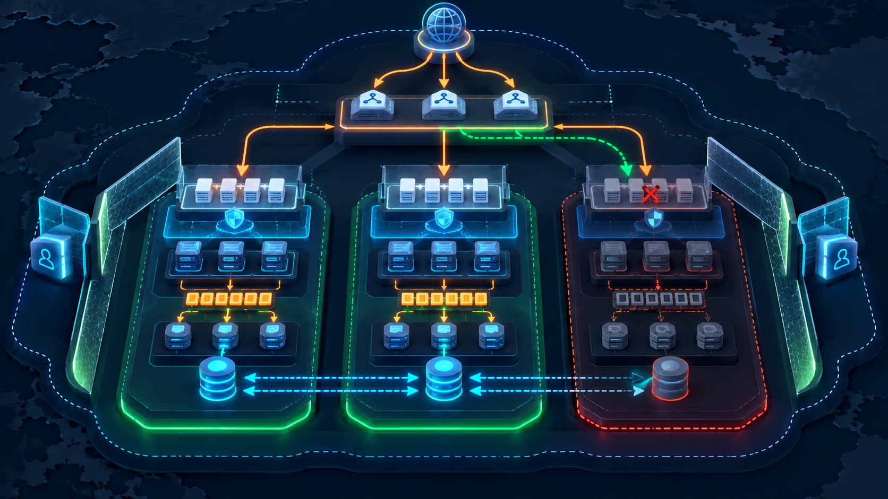

# Domain 1 — Design Secure Architectures (30%)

> **Outcome:** Design secure access, workloads, applications, networks, and data controls using least privilege and defense in depth.

## Identity and accounts

- Protect the root user, enable MFA, and avoid routine root use.
- Prefer federation and IAM Identity Center for workforce access.
- Prefer roles and temporary credentials for workloads and cross-account access.
- IAM identity policies attach to identities; resource policies attach to supported resources.
- An explicit deny overrides an allow. Permissions boundaries and Organizations SCPs limit maximum permissions; they do not grant permissions.
- Separate workloads with accounts and organizational units to reduce blast radius.

## Network defense in depth

Public subnets have a route to an internet gateway; “public” does not automatically assign or expose every resource. Keep application and data tiers private when direct internet access is unnecessary.

| Control | Scope | State |
|---|---|---|
| Security group | ENI/resource | Stateful; allow rules only |
| Network ACL | Subnet | Stateless; allow and deny rules |
| AWS WAF | HTTP(S) application layer | Filters web requests |
| AWS Shield | DDoS protection | Protects against denial-of-service attacks |
| AWS Network Firewall | VPC network inspection | Managed network firewall controls |

Use VPC endpoints for private access to supported services. Use Secrets Manager or Parameter Store appropriately instead of placing secrets in code or images.

## Data protection

- Encrypt in transit with TLS and at rest with the service's supported encryption.
- KMS controls keys and authorizations; key policies matter.
- S3 Block Public Access, bucket policies, Object Ownership, and access points help control object access.
- Classify data, define retention, versioning, backup, replication, and deletion requirements.
- Macie discovers sensitive S3 data; GuardDuty detects suspicious activity; Inspector assesses workload vulnerabilities; Security Hub aggregates findings.

## Shared responsibility

AWS operates physical facilities and the underlying cloud. Customers configure identities, data access, network controls, workload software, and service settings. Managed services move more operational responsibility to AWS, but never remove customer responsibility for data and configuration.

## Self-check

1. Why can an SCP not grant a developer S3 access?
2. When is a resource policy useful for cross-account access?
3. Why must a NACL allow return traffic explicitly?
4. Which service addresses SQL-injection patterns at the web edge?

<a href="../README.md">↑ Guide</a> · <a href="02-resilient-architectures.md">Resilience →</a>

